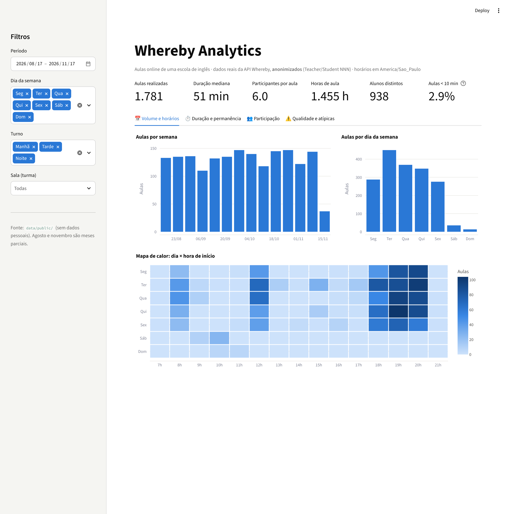
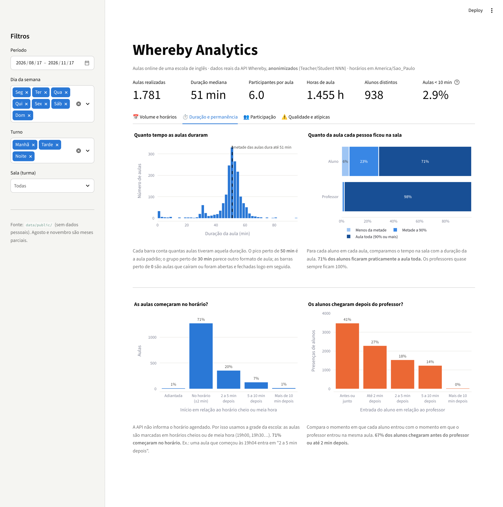
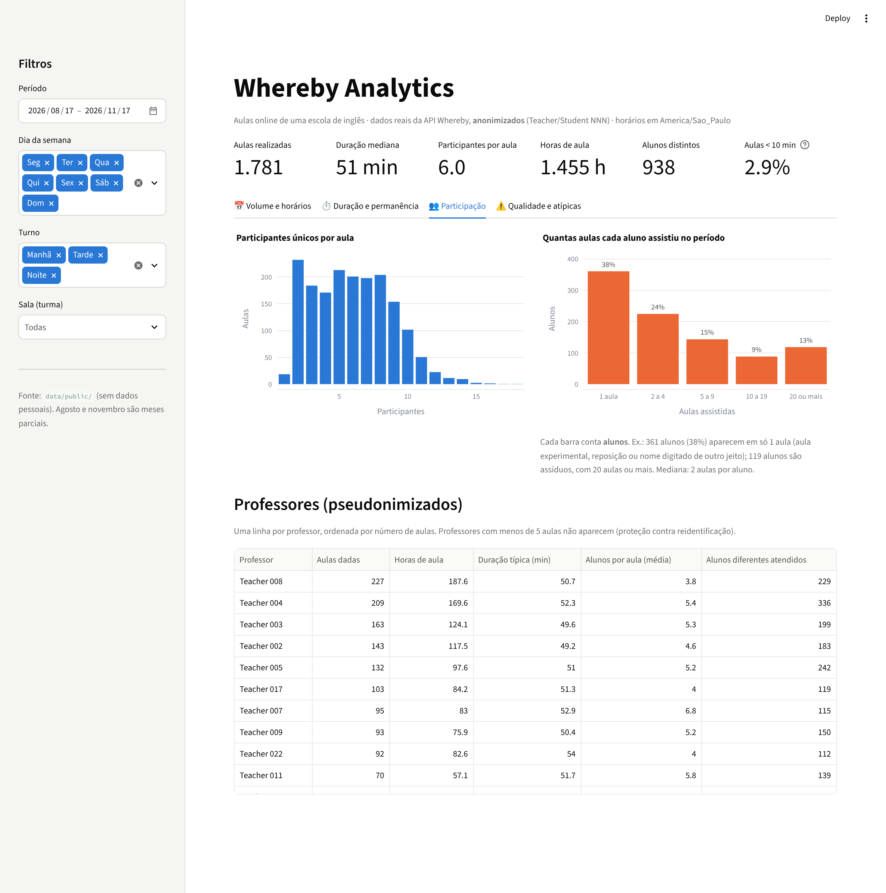
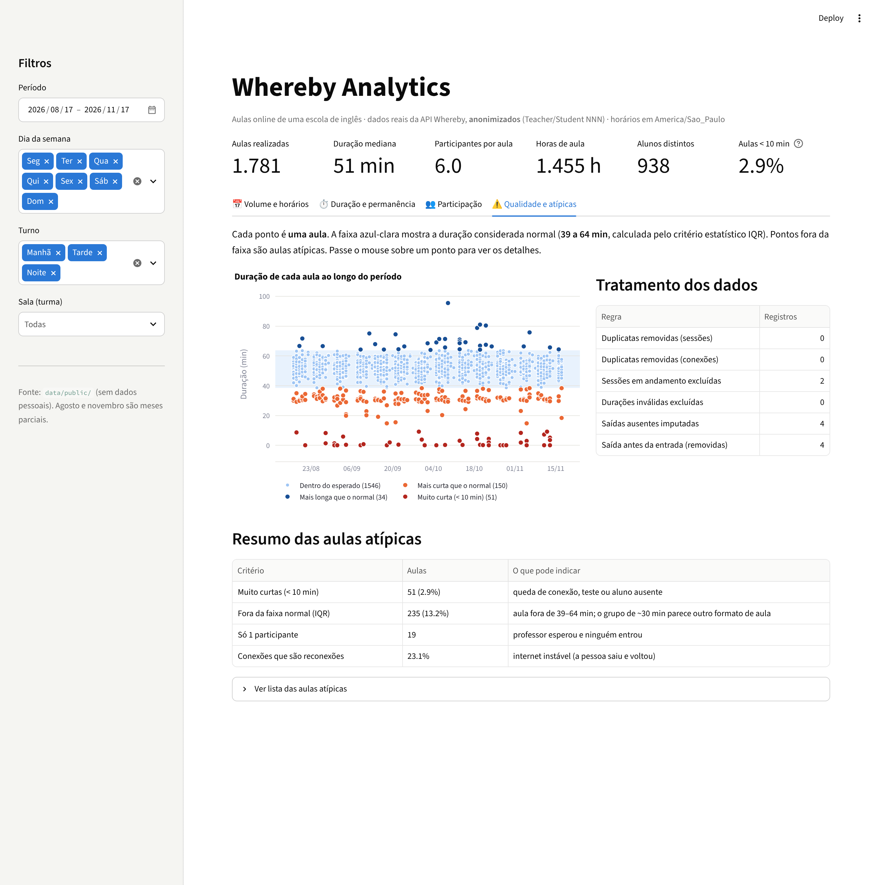

# Whereby Analytics

**Projeto acadêmico, disciplina Big Data em Python.**

Este projeto analisa **3 meses de aulas online reais** de uma escola de inglês. Os dados vêm da API do Whereby, a plataforma de videoconferência que a escola usa. O processo completo foi feito em Python: coleta, limpeza, anonimização, análise exploratória e um dashboard interativo.

| | |
|---|---|
| **Período** | 17/08/2026 a 17/11/2026 |
| **Volume** | 1.781 aulas e 13.506 registros de participação |
| **Pessoas** | 29 professores e 938 alunos, todos anonimizados |
| **Tecnologias** | Python, Requests, Pandas, NumPy, Matplotlib, Seaborn, Plotly, Streamlit, SQLite, Parquet |

**Onde ver cada parte:**
- 📊 **Dashboard online:** **https://whereby-analytics.streamlit.app/** (código em [`dashboard/app.py`](dashboard/app.py))
- 📓 **Análise exploratória**, com código, gráficos e conclusões: [`notebooks/02_analise_exploratoria.ipynb`](notebooks/02_analise_exploratoria.ipynb). O GitHub mostra o notebook já executado.
- 🗂️ **Dataset anonimizado:** [`data/public/`](data/public), em CSV e Parquet.
- 📄 **Relatório de viabilidade técnica:** [`docs/01_relatorio_viabilidade.md`](docs/01_relatorio_viabilidade.md).

---

## Requisitos da disciplina

| Requisito | Onde está atendido |
|---|---|
| Pelo menos 1.000 registros | 1.781 aulas e 13.506 participações ([`data/public/`](data/public)) |
| Importação, limpeza e tratamento | [`src/wa/build_dataset.py`](src/wa/build_dataset.py) e seção 1 do notebook |
| Valores ausentes, duplicatas e inconsistências | [`quality_report.json`](data/public/quality_report.json) e a seção [Tratamento dos dados](#tratamento-dos-dados) abaixo |
| Pelo menos 5 análises exploratórias | 8 análises no notebook (lista abaixo) |
| Dashboard com 4+ gráficos e 3+ indicadores | 10 gráficos e 6 indicadores em 4 abas ([capturas de tela](#dashboard)) |
| Conclusões | Seção [Principais conclusões](#principais-conclusões) e o final do notebook |

---

## Principais conclusões

1. **Volume estável.** Cerca de **134 aulas por semana**, sendo 97% de segunda a sexta. Terça-feira é o dia mais movimentado.
2. **Duração muito padronizada.** A duração mediana é de **51 min**, e metade das aulas dura entre 48 e 54 min. Há também um grupo menor de aulas de cerca de 30 min, que parece ser outro formato de aula.
3. **Horário de pico à noite.** A maioria das aulas começa entre **19h e 20h** (horário de Brasília). Há faixas menores às 8h e ao meio-dia, o que sugere um público que estuda antes ou depois do trabalho.
4. **Turmas pequenas.** São **6 participantes por aula** em média, contando o professor.
5. **Pontualidade.** **71% das aulas começam no horário**, com até 2 min de diferença do horário cheio ou da meia hora. Só 8% começam mais de 5 min atrasadas.
6. **Alunos presentes.** **71% dos alunos ficam praticamente a aula toda** (90% ou mais), e 67% entram antes do professor ou até 2 min depois dele.
7. **Poucas aulas problemáticas.** 2,9% das aulas duraram menos de 10 min, o que pode indicar queda de conexão, teste ou aluno ausente. Por outro lado, **23% das conexões são reconexões**, ou seja, a pessoa saiu e voltou. Isso aponta para instabilidade de internet.
8. **Frequência desigual.** 39% dos alunos aparecem em uma aula só, o que pode indicar aula experimental, reposição ou nome digitado de outro jeito. Já 13% são assíduos, com 20 aulas ou mais em 3 meses.

### Análises realizadas (notebook)

| # | Análise | Gráfico |
|---|---|---|
| 1 | Aulas por dia, semana e mês | [aulas por dia](docs/figures/01_aulas_por_dia.png), [semana e mês](docs/figures/02_aulas_semana_mes.png) |
| 2 | Duração média das aulas | [duração](docs/figures/03_duracao.png) |
| 3 | Distribuição dos horários de início | [mapa de calor](docs/figures/04_heatmap_horarios.png) |
| 4 | Participantes por aula | [participantes](docs/figures/05_participantes_por_aula.png) |
| 5 | Tempo de permanência na aula | [permanência](docs/figures/06_permanencia.png) |
| 6 | Horário previsto × realizado | [pontualidade](docs/figures/07_previsto_realizado.png) |
| 7 | Aulas muito curtas ou atípicas | [atípicas](docs/figures/08_atipicas.png) |
| 8 | Frequência de participação dos alunos | [frequência](docs/figures/09_frequencia_alunos.png) |

---

## Dashboard

**Acesse em: https://whereby-analytics.streamlit.app/**

O dashboard tem filtros por período, dia da semana, turno e sala, e é organizado em 4 abas. No topo ficam 6 indicadores: aulas realizadas, duração mediana, participantes por aula, horas de aula, alunos distintos e % de aulas com menos de 10 min.

**Volume e horários:** aulas por semana, por dia da semana e um mapa de calor de dia × hora.



**Duração e permanência:** duração das aulas, quanto da aula cada pessoa ficou, pontualidade e chegada dos alunos.



**Participação:** participantes por aula, frequência dos alunos e um resumo por professor.



**Qualidade e atípicas:** cada aula como um ponto, mostrando quais fogem do normal, e as regras de tratamento aplicadas.



---

## Tratamento dos dados

| Problema encontrado | Quantidade | Tratamento |
|---|---:|---|
| Sessões duplicadas | 0 | remoção pela chave `roomSessionId` |
| Participações duplicadas | 0 | remoção pela chave (sessão, participante, entrada) |
| Aulas ainda em andamento na coleta (sem horário de fim) | 2 | excluídas |
| Participações dessas aulas | 7 | excluídas |
| Participações sem horário de saída | 4 | imputado o horário de fim da aula |
| Saída registrada antes da entrada | 4 | excluídas (inconsistência) |
| Durações inválidas (≤ 0 ou > 6 h) | 0 | seriam excluídas |
| Campos vazios na API (`externalId` e `userAgent` em 100% das linhas, `userId` em 99%) | — | descartados (sem uso e potencialmente pessoais) |

Os números completos estão em [`data/public/quality_report.json`](data/public/quality_report.json).

---

## Privacidade

Os dados são reais, então **nenhuma informação pessoal foi publicada**:

- **Pseudônimos.** Nomes de professores e alunos foram trocados por `Teacher 001`, `Student 001` etc., e as salas por `Room 001`. A troca usa **HMAC-SHA256** com um segredo que não está no repositório, então não é possível descobrir os nomes a partir dos pseudônimos. A mesma pessoa recebe sempre o mesmo pseudônimo.
- **O que não está no repositório:**
  - nomes, e-mails, IDs originais da API e links de salas;
  - gravações, transcrições e credenciais;
  - os dados brutos e a tabela de correspondência, que ficam em `data/private/`, pasta ignorada pelo Git.
- **Generalização.** As aulas têm só a data e a hora cheia. As participações não têm horário absoluto, só minutos contados a partir do início da aula.
- **Grupos pequenos.** Professores com menos de 5 aulas não aparecem individualmente no dashboard.
- **Verificação automática.** [`src/wa/check_privacy.py`](src/wa/check_privacy.py) compara todos os arquivos públicos com os nomes e IDs reais e bloqueia a publicação se encontrar qualquer um.
- **Somente leitura.** A coleta usou apenas requisições de leitura (`GET`) e deixou 50% da cota da API livre, para não interferir nas aulas da escola.

---

## Dicionário de dados

### `sessions` (uma linha por aula)

| Coluna | Descrição |
|---|---|
| `session_id` | pseudônimo da aula (`Session 00001`) |
| `room_id` | pseudônimo da sala (`Room 001`) |
| `date`, `year_week`, `month`, `weekday` | data da aula e derivados |
| `start_hour`, `end_hour` | hora cheia de início e fim (horário de Brasília) |
| `slot_offset_min` | minutos entre o horário cheio ou a meia hora e o início real (negativo = adiantada) |
| `duration_min` | duração da aula em minutos |
| `api_unique_participants` | participantes únicos, segundo a API |
| `participant_minutes` | soma dos minutos de todos os participantes |
| `n_people`, `n_teachers`, `n_students` | pessoas distintas na aula, no total e por papel |
| `n_segments` | conexões (cada entrada na sala conta uma) |
| `is_short` | aula com menos de 10 min |

### `participations` (uma linha por entrada de uma pessoa na sala)

| Coluna | Descrição |
|---|---|
| `session_id` | aula |
| `person_id` | pseudônimo da pessoa (`Teacher 001` / `Student 001`) |
| `role` | `teacher` ou `student` |
| `join_offset_min` | minutos entre o início da aula e a entrada da pessoa |
| `stay_min` | minutos que a pessoa ficou nessa conexão |
| `segment_n`, `is_reconnection` | número da conexão da pessoa na aula; `True` se for uma reconexão |

### `rooms` (uma linha por sala)

Contém o número de aulas, o primeiro e o último mês com aulas, a duração média e a média de pessoas por aula.

---

## Como executar

Para só ver o dashboard, basta abrir o [link online](https://whereby-analytics.streamlit.app/). Para rodar localmente, não é preciso ter acesso à API: o dashboard e o notebook usam apenas os arquivos de `data/public/`.

```bash
git clone https://github.com/claudiomvpereira/whereby-analytics.git
cd whereby-analytics
pip install -r requirements.txt

streamlit run dashboard/app.py                               # dashboard (abre em http://localhost:8501)
jupyter notebook notebooks/02_analise_exploratoria.ipynb     # notebook
python -m pytest -q tests                                     # testes automáticos
```

<details>
<summary>Recriar os dados a partir da API (exige credenciais da escola)</summary>

```bash
cp .env.example .env    # preencha WHEREBY_API_KEY e PSEUDONYM_SECRET (64+ caracteres aleatórios)
export $(grep -v '^#' .env | xargs)

PYTHONPATH=src python -m wa.collect --since 2026-08-17       # coleta (algumas horas; pode ser retomada)
PYTHONPATH=src python -m wa.build_dataset --since 2026-08-17  # limpeza + anonimização → data/public/
PYTHONPATH=src python -m wa.check_privacy                     # verificação de privacidade
```
</details>

---

## Arquitetura

```
API Whereby ──collect──> data/private/whereby.sqlite   (dados brutos, fora do Git)
            ──build_dataset──> data/public/*.csv|parquet + quality_report.json
            ──check_privacy──> OK → notebook e dashboard
```

```
src/wa/client.py          cliente da API somente leitura, respeita o limite de requisições
src/wa/collect.py         coleta incremental e retomável → SQLite privado
src/wa/anonymize.py       pseudonimização HMAC-SHA256
src/wa/build_dataset.py   limpeza, tratamento e anonimização → data/public/
src/wa/check_privacy.py   bloqueia nomes ou IDs reais nos arquivos públicos
notebooks/                análise exploratória (.ipynb executado + .py)
dashboard/app.py          dashboard Streamlit + Plotly
tests/                    teste ponta a ponta com dados fictícios
docs/                     relatório de viabilidade, figuras e capturas de tela
poc/                      prova de conceito da conexão com a API
```

---

## Limitações

- **Sem horário agendado.** A API não informa o horário marcado da aula, porque as salas da escola são fixas. A pontualidade foi estimada pela grade da escola (horário cheio ou meia hora).
- **Identificação pelo nome digitado.** A API não tem um código fixo por aluno, então cada pessoa é identificada pelo nome digitado ao entrar. Se alguém escreve o nome de outro jeito, conta como outra pessoa, e por isso a frequência por aluno é aproximada.
- **Meses parciais.** O período cobre 3 meses: agosto e novembro estão incompletos.
